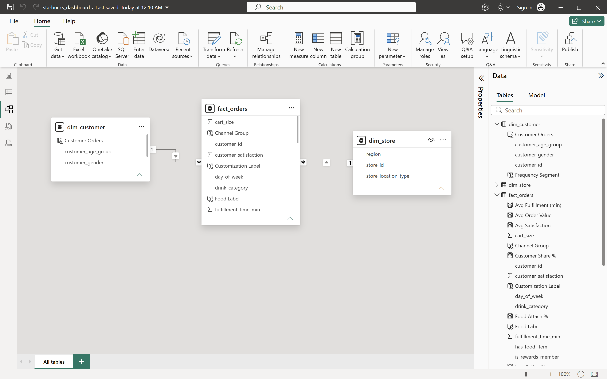
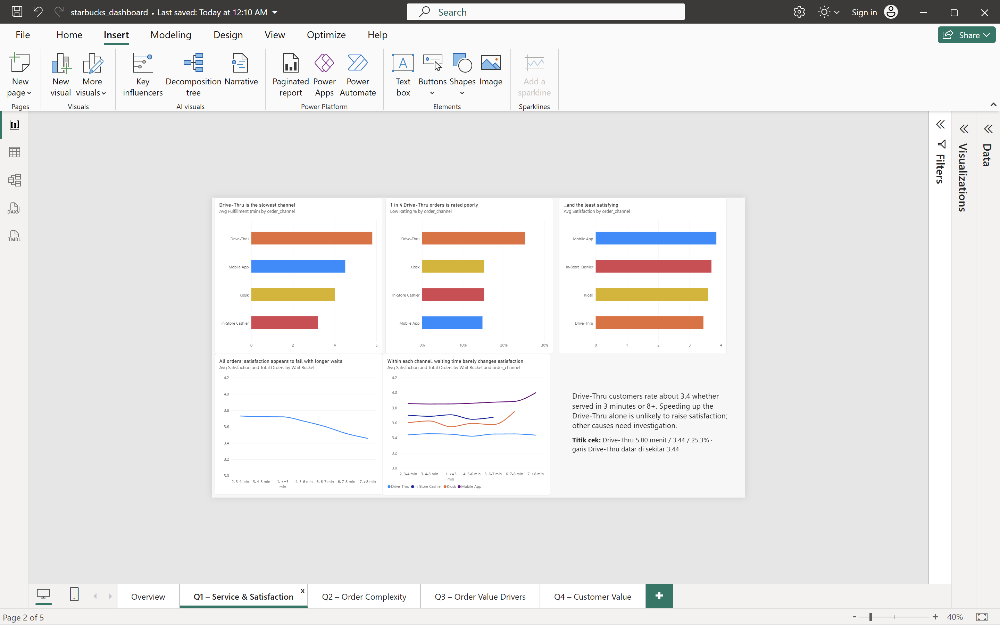
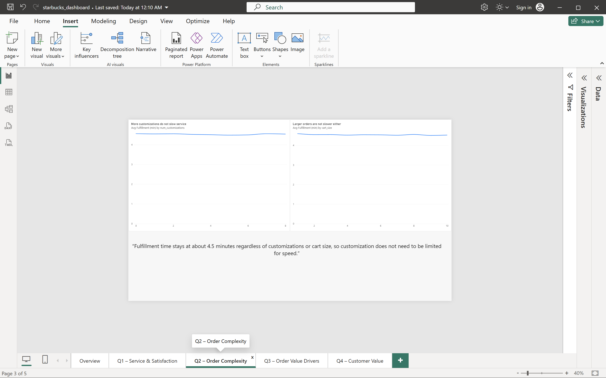
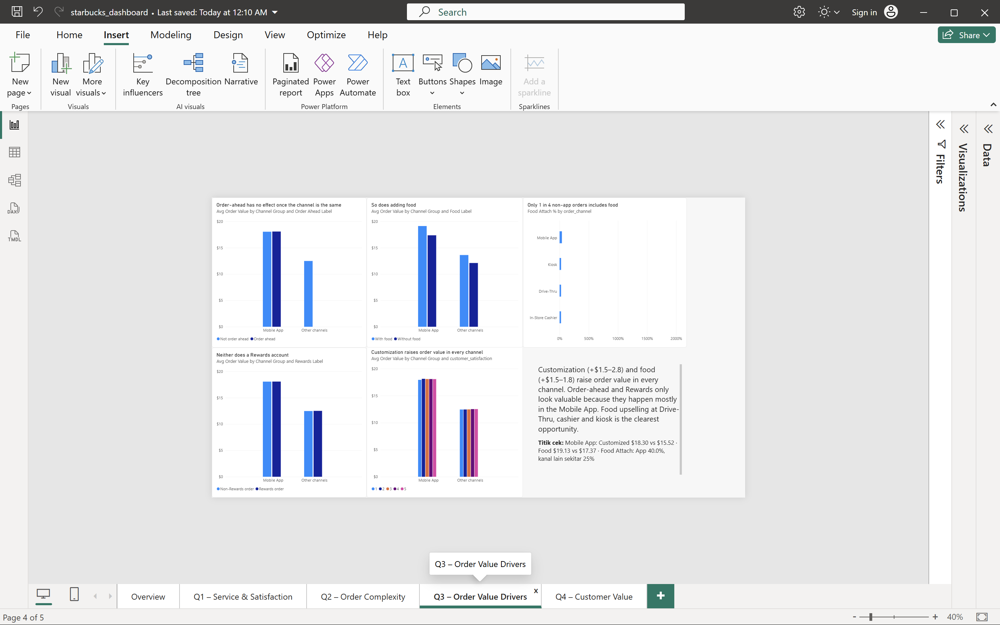
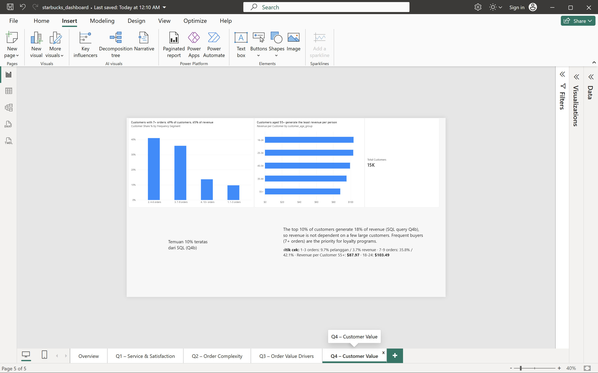

# Coffee Chain Order Analysis — SQL & Power BI

End-to-end analysis of 100,000 coffee shop orders: data import and validation in MySQL, data cleaning, a star schema data model, SQL analysis of four business questions, and a Power BI dashboard.

> **Note:** This project uses a **synthetic** Starbucks-style dataset from Kaggle. It does not represent real Starbucks performance. Findings demonstrate the analysis approach, not real business results.

## Business Problem

A coffee chain wants to improve customer experience and increase revenue per order. Management needs to know where the customer experience is weakest, which factors raise the value of an order, and which customers generate the most revenue.

| # | Question | Stakeholder |
|---|---|---|
| Q1 | Which ordering channel has the slowest service and the lowest satisfaction? | Operations |
| Q2 | Do more complex orders take longer to fulfill? | Operations |
| Q3 | Which factors increase order value? | Marketing |
| Q4 | How is revenue distributed across customers by purchase frequency? | Marketing |

Full problem statement and scope: [business_questions.md](business_questions.md)

## Dataset

- **Source:** [Starbucks Customer Ordering Patterns – Kaggle](https://www.kaggle.com/datasets/likithagedipudi/starbucks-customer-ordering-patterns) (license: CC0: Public Domain*)
- **Size:** 100,000 orders · 14,988 customers · 500 stores · 1 Jan 2024 – 30 Dec 2025
- **Columns:** order details (channel, date, time, cart size, customizations, food item, order-ahead, Rewards account), store details (region, location type), customer details (age group, gender), outcomes (total spend, fulfillment time, satisfaction score 1–5)

## Tools

MySQL 26.10 · MySQL Workbench 26 · Power BI Desktop (DAX, Power Query)

## Workflow

| Step | File | What it does |
|---|---|---|
| 1. Setup & import | [01_setup_and_import.sql](sql/01_setup_and_import.sql) | Creates the database, loads the CSV into a raw staging table (all text), validates row counts |
| 2. Data understanding | [02_data_understanding.sql](sql/02_data_understanding.sql) | Profiles every column: categories, blanks, numeric ranges, consistency of customer and store attributes |
| 3. Data cleaning | [03_data_cleaning.sql](sql/03_data_cleaning.sql) | Validates formats, converts to proper data types with constraints, reconciles totals before and after |
| 4. Data modeling | [04_data_modeling.sql](sql/04_data_modeling.sql) | Builds a star schema with primary and foreign keys, checks for orphan records |
| 5. Analysis | [05_analysis.sql](sql/05_analysis.sql) | Answers Q1–Q4 using CTEs, CASE, conditional aggregation, UNION ALL and window functions |
| 6. Dashboard | [starbucks_dashboard.pbix](powerbi/starbucks_dashboard.pbix) | Power BI report connected directly to MySQL |

## Data Model



- **fact_orders** (100,000 rows): one row per order
- **dim_customer** (14,988 rows): age group and gender, which never change per customer
- **dim_store** (500 rows): region and location type, which never change per store

`is_rewards_member` stays in the fact table because it changes between orders for most customers (see Data Quality Findings).

## Data Quality Findings

- **Import check:** an accidental repeated load produced 600,000 rows; validating `COUNT(*)` against `COUNT(DISTINCT order_id)` caught it, and the table was reloaded with an idempotent script (TRUNCATE before LOAD).
- **No blanks, invalid dates, out-of-range values or duplicate orders** were found. `day_of_week` matches the order date for every row.
- **Logical check passed:** order-ahead orders exist only in the Mobile App.
- **Rewards status is inconsistent:** 13,873 of 14,988 customers (93%) switch between Rewards and non-Rewards across orders. The column is treated as *"a Rewards account was used on this order"*, which is supported by Mobile App orders being flagged far more often (64.6%) than other channels (about 35%). All Rewards findings are reported at order level.
- **Out of scope:** region, store location type, drink category and month show near-identical values (average spend $14.81–$14.92; monthly revenue flat at about $59–65K), typical of synthetic data, so they were not analyzed further.

## Key Insights

### Q1. Drive-Thru is the slowest and least satisfying channel, but speed is not the reason

| Channel | Avg fulfillment | Avg satisfaction | Poor ratings (1–2) |
|---|---|---|---|
| Drive-Thru | **5.80 min** | **3.44** | **25.3%** |
| Mobile App | 4.51 min | 3.86 | 14.8% |
| Kiosk | 4.01 min | 3.60 | 15.2% |
| In-Store Cashier | 3.20 min | 3.70 | 15.2% |

Across all orders, satisfaction appears to fall with longer waits (3.72 at ≤3 min vs 3.46 at >8 min). **Within each channel, however, satisfaction barely changes with waiting time.** Drive-Thru customers rate about 3.44 whether served in 3 minutes or more than 8. The apparent decline is a channel-mix effect: 96% of orders that wait more than 8 minutes are Drive-Thru orders.

### Q2. Complex orders are not slower

Average fulfillment time stays between 4.49 and 4.60 minutes for 0 to 8 customizations and for 1 to 10 items. Customization does not need to be limited for speed.

### Q3. Customization and food drive order value; order-ahead and Rewards do not

| Factor | Difference (all orders) | Difference within Mobile App | Difference within other channels |
|---|---|---|---|
| Customization | +$3.37 | **+$2.78** | **+$1.52** |
| Food item | +$2.52 | **+$1.76** | **+$1.51** |
| Order ahead | +$4.59 | +$0.04 | n/a |
| Rewards account | +$1.63 | +$0.01 | +$0.03 |

Order-ahead and Rewards orders only look more valuable because they happen mostly in the Mobile App, where orders are larger ($18.08 vs about $12.50). Once compared within the same channel, the difference disappears. Food is added to **40.0%** of Mobile App orders but only **25.0–25.8%** of Drive-Thru, cashier and kiosk orders.

### Q4. Frequent customers generate most revenue, and revenue is not concentrated

| Segment | Share of customers | Share of revenue | Revenue per customer |
|---|---|---|---|
| 1–3 orders | 9.7% | 3.7% | $37.67 |
| 4–6 orders | 40.9% | 31.5% | $76.42 |
| 7–9 orders | 35.8% | 42.1% | $116.83 |
| 10+ orders | 13.7% | 22.7% | $164.73 |

- Customers with **7 or more orders (49% of customers) generate 65% of revenue.**
- The **top 10% of customers generate 18% of revenue**, so the business does not depend on a few large customers.
- Customers aged **55+** order as often as other groups (6.7 orders) but generate the least revenue per person ($87.97 vs $103.49 for ages 18–24).

## Recommendations

1. **Investigate the Drive-Thru experience beyond speed** (for example order accuracy, menu board, staff interaction) through customer surveys before investing in faster service, since faster service alone is unlikely to raise satisfaction.
2. **Promote food add-ons at the Drive-Thru, cashier and kiosk**, where only about 1 in 4 orders includes food compared with 2 in 5 in the Mobile App.
3. **Keep encouraging customization**: it raises order value in every channel without slowing service.
4. **Focus loyalty efforts on frequent buyers** (7+ orders) and on moving 4–6 order customers into that group.
5. **Do not treat order-ahead or Rewards as value drivers** in planning until membership can be measured reliably at customer level.

## Limitations

- The dataset is synthetic; patterns reflect how the data was generated, not real customer behaviour.
- Rewards membership is an assumption at order level (see Data Quality Findings).
- No cost or margin data is available, so conclusions are based on revenue, not profit.
- Some groups are small (for example 70 Mobile App orders waiting more than 8 minutes), so their averages are less reliable.

## Dashboard

| Overview | Q1 – Service & Satisfaction |
|---|---|
|  |  |
| **Q2 – Order Complexity** | **Q3 – Order Value Drivers** |
|  |  |
| **Q4 – Customer Value** | |
|  | |

## Repository Structure

```
├── README.md
├── business_questions.md
├── sql/
│   ├── 01_setup_and_import.sql
│   ├── 02_data_understanding.sql
│   ├── 03_data_cleaning.sql
│   ├── 04_data_modeling.sql
│   └── 05_analysis.sql
├── powerbi/
│   └── starbucks_dashboard.pbix
└── images/
    └── dashboard and data model screenshots
```

## How to Reproduce

1. Download the CSV from Kaggle and place it in the MySQL `secure_file_priv` folder (check with `SHOW VARIABLES LIKE 'secure_file_priv';`).
2. Update the file path in `01_setup_and_import.sql`, then run scripts `01` to `05` in order.
3. Open `starbucks_dashboard.pbix`, update the MySQL connection if needed (Transform data → Data source settings), and refresh.

## Author

**Helga Yuliani Putri Aritonang** · [LinkedIn](https://www.linkedin.com/in/helgayulianiputriaritonang) · [GitHub](https://github.com/Hy-putri)
